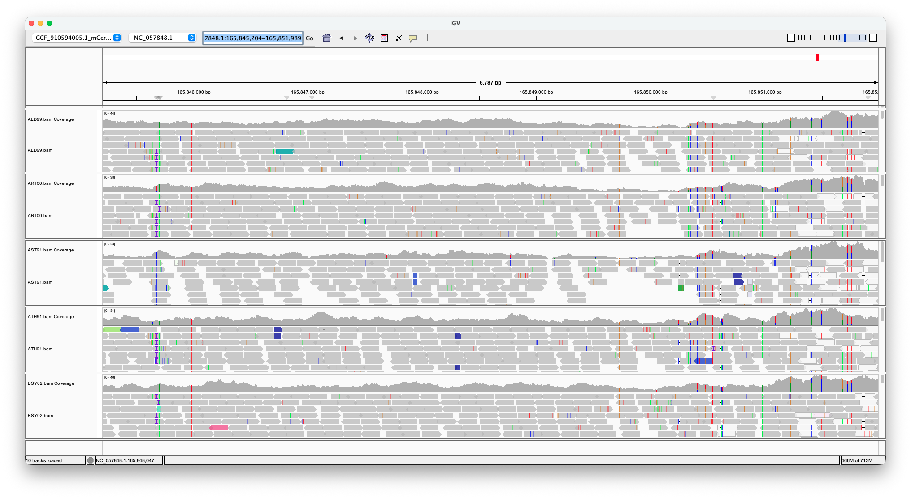

# RumDeer
Guide to calling variants from whole genome sequencing using the Rum Deer dataset as an example. The three steps outlined are what I used for the Soay sheep, reindeer, and sparrows.

## 01 Pseudo-autosomal region checks
In chromosomal assemblies which contain both sex chromosomes it's necessary to check if the pseudoautosomal region (PAR) is present on both sex chromosomes, and where the boundaries of the PAR are. If it is present on both sex chromosomes it should be masked on heteromorphic chromosome before reads are aligned to prevent multimapping. The red deer assembly doesn't contain the Y chromosome, so this isn't necessary here. However, independant of whether the PAR is on one or both sex chromosomes (or only the homomorphic sex chromosome is included), the variant caller needs to be told where the PAR's boundary are to ensure the remainder of the sex chromosomes can be properly called as diploid, haploid or absent.

As reference genome papers might not include details about the PAR, we'd first check if it's on both sex chromosomes by aligning them to each other using [D-GENIES](https://dgenies.toulouse.inra.fr/) (run locally). The reindeer and sheep variant calling has more detailed descriptions of this. In the sheep both sex chromosomes contained the PAR, while in the reindeer only the X did.

### Approach 1
If the PAR's not present on both sex chromosomes, it's normally present on the Z/X. Examining read coverage/depth across the Z/X in a male/female (respecitvely) enables us to determine where the PAR begins/ends. In the case of the red deer, the reference genome doesn't contain the Y chromosome, so this step will also help us determine if the PAR is on the X (I expect it will be).

To determine the rough boundaries of the PAR we'll look at read coverage of a male across the X chromosome, calculating read depth across the smallest autosome and X chromosome with `samtools depth` and finding where coverage drops to half on the X chromosome and heterozygous SNPs are no longer present.

### Approach 2
The second approach I've tried is to use the flanking sequences of the SNPs to look for the actual coordinate of each known PAR SNP using BLAST (for the entire method see (this script)[01_par_check/scripts/par_snps_flank.R] ). Unfortunately, rather than recovering the SNPs positions I've instead found that
- While the genome sequence found between the flanks using BLAST matches either the reference or alternative of the that in the (DeerSNPSeq.txt)[01_par_check/data/Deer_SNP_FASTA/1_DeerSNPSeq.fa]...
- ...it does not match the sequence included in the PLINK `.bim` file
As a result I'm using the above coordinates of the PAR as a rough guide, and will examine the alignment of males to the X chromosome in IGV to see where coverage drops by half and heterozygous SNPs are no longer present.

From scrolling through in IGV coverage doubles and heterozygous SNPs first appear at ~165,850,000bp on chromosome X (NC_057848.1):

Based on this the PAR will be defined as 165,850,000 - 179,953,079.

## 02 Read alignment
Seeing as each sample was sequenced over multiple lanes, each sample has multiple paired read fastq files. For sample we're:

1) Trimming off sequencing adapters using `fastp`
2) Aligning paired libraries using `minibwa`
3) Merging each the samples aligned reads into a single file using `samtools`
4) Deduplicating the merged alignments using `samtools`

If each sample only had one pair of fastq files we could skip step 3. If we had sequenced the deer with PacBio or Nanopore we'd use `minimap2` as the aligner rather than `minibwa`.

## 03 Variant calling
We are performing calling using the bcftools package. For variant calling we create a 'pileup' using `bcftools mpileup` which is piped into `bcftools call` for variant calling. By default `bcftools` treats all chromosomes as diploid in all samples. To change this for the PAR and the mitochondria we need to provide a `--ploidy-file` which the coordinates of chromosomes where the ploidy deviates from 2, what the ploidy is acrosss that region, and which sex it deviates in; and a `--samples-file` outlining the sex of each sample. Seeing as we're calling each chromosome in a seperate script we don't need to provide these when calling the autosomes.

